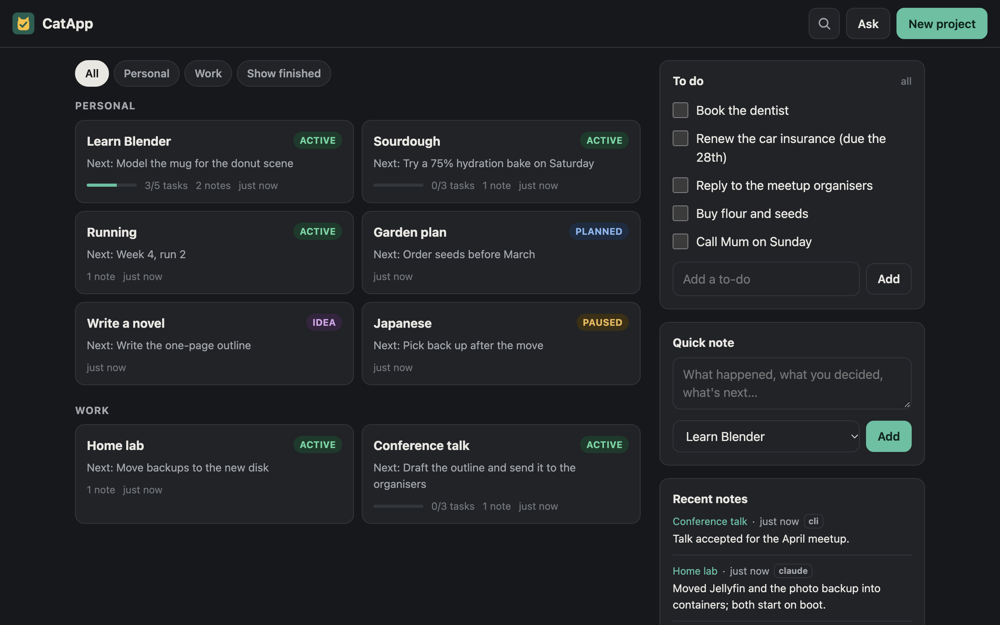
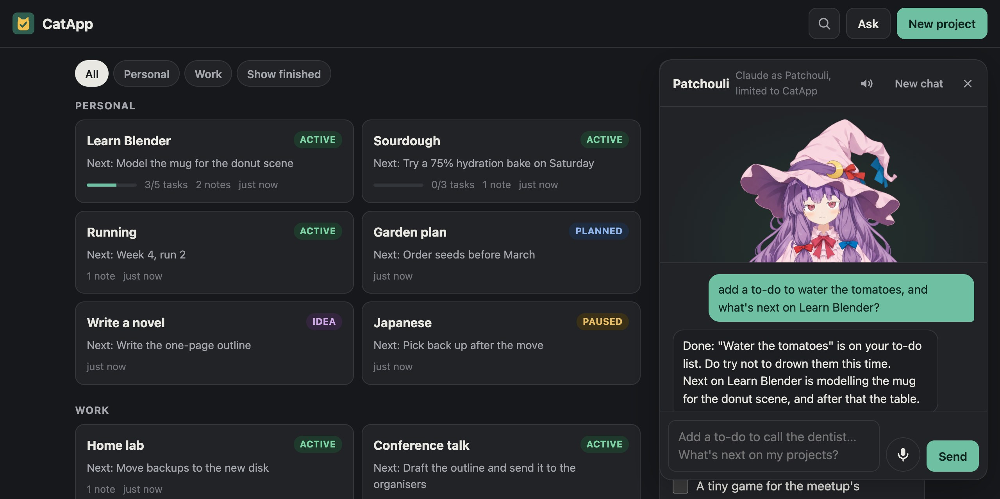
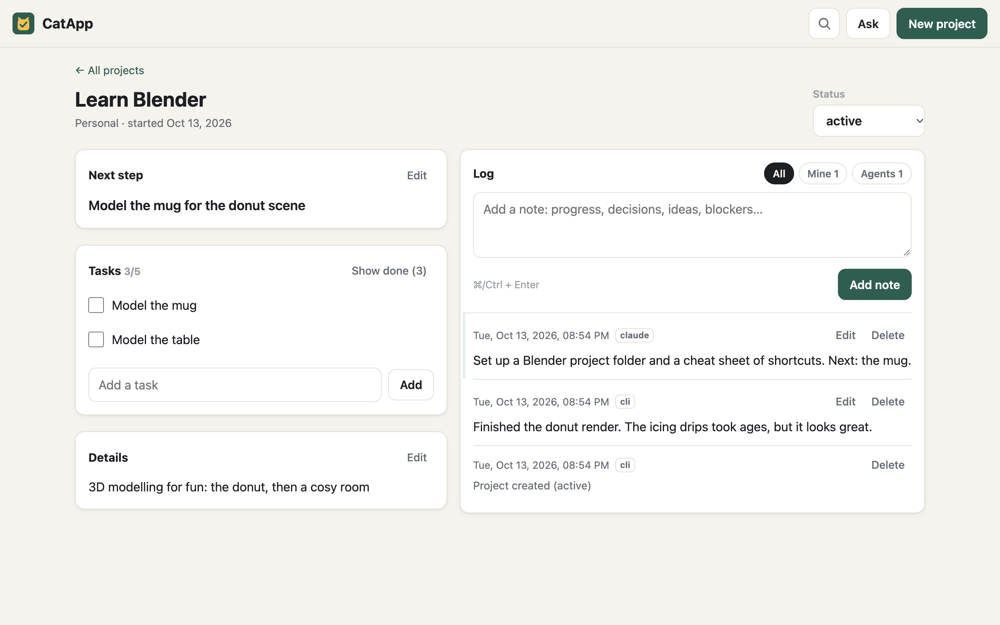
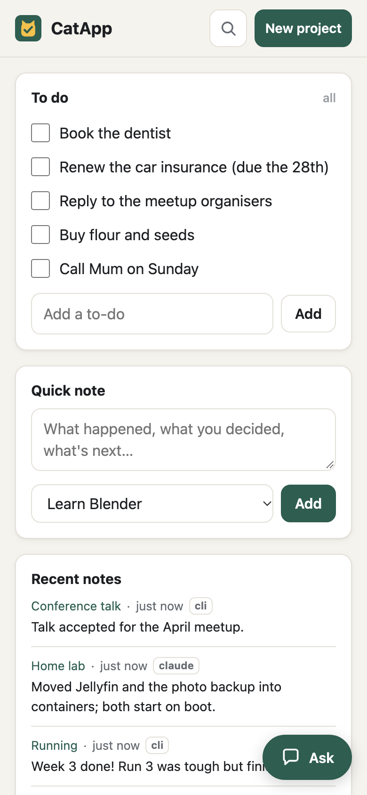

# CatApp

<a href="docs/screenshots/home.png"></a>
<a href="docs/screenshots/assistant.jpg"></a>
<a href="docs/screenshots/project.png"></a>
<a href="docs/screenshots/phone.png"></a>

A little personal organiser for keeping track of my life and all my projects.

I've always got far too many things on the go (side projects, work ideas, learning
things, life admin) and I'm not very organised. I'd start something, get distracted,
and a month later have no idea where I'd left it. Every to-do app I tried was either too
much faff or didn't know about the coding projects I spend most of my time on, so I
made my own.

Every project gets a status, a next step, a checklist and a log of dated notes, so
picking something back up is just a case of reading what past me wrote. There's a
to-do list and an ideas list on the front page for everything else.

It's also built for working with AI agents. Claude (or any other agent) can read it and
post notes over MCP, so when an agent finishes some work in one of my repos it leaves a
note on that project saying what changed and what's next. There's also a built-in
assistant: press Ask and say "add a to-do to book the dentist" or "what's next on my
projects?". If you want, you can even talk to it and have it talk back, with a
character and an animated Live2D avatar.

It runs on your own computer (macOS or Linux), keeps everything in one SQLite file, and
works from your phone over your home Wi-Fi. My wife runs her own copy under a different
name, so you can call yours whatever you like.

## Getting it running

You'll need [Rust](https://rustup.rs). Then, from this folder:

```sh
cargo install --path .
catapp config name MyApp        # optional: call it whatever you like
catapp config owner Sam         # your first name, for the assistant
catapp service install          # keep it running in the background
```

Open <http://localhost:8787>. For your phone, run `catapp url` and scan the QR code.

From a terminal it's things like `catapp todo "pay the gas bill"`,
`catapp note blender "finished the donut"` and `catapp ls`.

## Optional extras

- **The assistant:** install [Claude Code](https://claude.com/claude-code) and log in
  once, and the Ask button works. It can only touch the app (no shell, files or web),
  and it uses your own Claude login.
- **Agents posting updates:** `claude mcp add --scope user catapp -- catapp mcp`, then
  tell your agents to post a note at the end of each session.
- **Voice mode** (Apple Silicon Macs): `sh voice/setup.sh`, then `catapp config voice on`.
  Speech runs locally ([Kokoro](https://huggingface.co/hexgrad/Kokoro-82M) and
  [Parakeet](https://huggingface.co/nvidia/parakeet-tdt-0.6b-v2)), and replies start in
  about a second and a half. `catapp config persona`, `memory` and `avatar` add a
  character, something for them to remember, and a Live2D avatar that lip-syncs.

Everything else (settings, the port, using it away from home, all the commands) is in
the [guide](docs/guide.md).

## License

[MIT](LICENSE)
